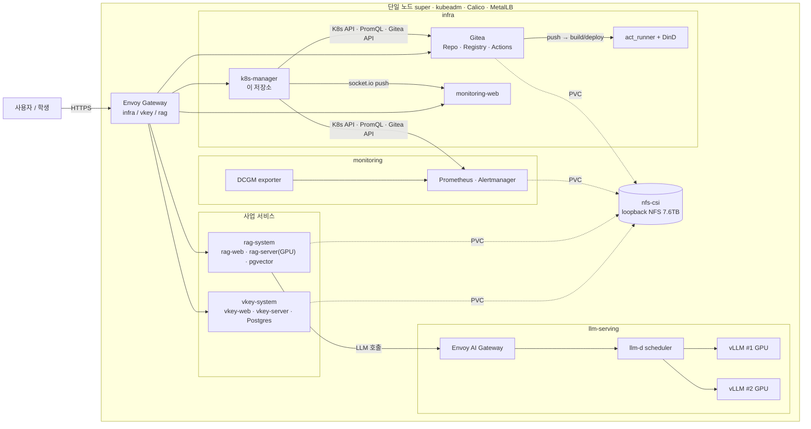

# k8s-manager — GPU 단일 서버 Kubernetes 운영 및 관리서버

대학 AI 사업 2개(가상키 발급 서비스, 문서 기반 RAG 질의 서비스)와 사내 LLM 서빙을 **GPU 서버 1대 위의 Kubernetes**로 구축·운영했다. 이 저장소에는 그 과정에서 만든 다음 세 가지가 들어 있다.

- **관리서버**: 클러스터 전체의 Pod/GPU 상태와 CI/CD 결과를 대시보드로 실시간 전달하는 Node.js 서버
- **인프라 매니페스트**: Helm Chart, Gateway, CI Runner 등
- **설계 기록**: 아키텍처 결정 기록(ADR) 49건

> 공개용으로 정리하면서 실제 IP, 도메인, 조직명은 예시값(`10.0.0.x`, `example.ac.kr`, `myorg`)으로 바꿨고 비밀번호와 토큰은 모두 제거했다.

---

## 운영 규모

| 항목 | 수치 |
|---|---|
| 지원 대상 | 개발팀 2개, 개발자 8명 |
| 운영 서비스 | 사업 서비스 2개 + 공용 LLM 서빙 + 인프라(Gitea, 모니터링) |
| 클러스터 | namespace 17 · Pod 67 · Deployment 43 · Service 57 · PVC 10 (1.4 TB) |
| 외부 진입점 | Gateway 5개(MetalLB L2 IP 5개), 도메인 3개, HTTPS |
| 하드웨어 | GIGABYTE G493-SB1-AAP1 · 128 thread · 512 GB RAM · NVIDIA L40S × 4 |
| LLM 서빙 | Gemma 4 12B, KServe + llm-d, vLLM Replica 2 |
| 서비스 사용자 | 가상키 서비스: 학생 100명, 가상키 370개 발급 |

## 아키텍처



- 상세 다이어그램(draw.io): [`docs/diagrams/cluster-architecture.drawio`](docs/diagrams/cluster-architecture.drawio). 모든 namespace, CIDR, NetworkPolicy 규칙을 포함한다.

## 주요 성과

### CI/CD 구축 (Gitea Actions, 2026-08-12 ~ 10-27)

| 항목 | 수치 |
|---|---|
| 적용 저장소 | 6개 |
| 파이프라인 실행 | 304회 (job 578건) |
| 자동 배포 | 269회, 성공률 93% |
| push → 배포 완료 | 중앙값 **38초**, p90 101초 |
| 월별 job 실패율 | **8월 13.0% → 9월 3.4% → 10월 2.2%** |

- Runner를 별도 Pod(DinD)로 분리했다. 그래서 빌드 권한(Docker 소켓)과 관리서버의 K8s API 권한이 섞이지 않는다 ([ADR-042](docs/adr/0042-cicd-runner-execution.md)).

### 장애 대응

| 사례 | 대응 전 | 대응 후 |
|---|---|---|
| OS 자동 업데이트로 인한 NFS 중단 | 전 서비스 26시간 19분 중단 | 원인 제거, 재발 0건 |
| GPU 드라이버 Pod 반복 재시작 | 219회 (부팅 시 커널 헤더 다운로드 실패) | 원인 해소, 0회 |
| GPU 모니터링 누락 | 수집 GPU 0장 (Prometheus 라벨 오류) | 4장 전체 수집 |
| Helm 업그레이드 실패 시 API 토큰 초기화 | 업그레이드 실패 때마다 재발 가능 | Secret 분리, 재발 0건 ([ADR-046](docs/adr/0046-helm-external-secret.md)) |

## 장애 사례: 자동 업데이트 한 번에 전 서비스 26시간 중단

**상황**
- 노드는 `Ready`였지만 가상키 API, RAG DB, Gitea, Prometheus가 동시에 응답하지 않았다.
- load average는 약 9,100이었는데 CPU 사용률은 2%였다.

**원인 추적**
1. load는 높은데 CPU가 놀고 있다 → 프로세스가 I/O 대기(D state)에 묶여 있다고 판단했다.
2. 영향받은 서비스의 공통점은 모두 `nfs-csi` PVC를 쓴다는 것이었다. `node_nfsd_packets_total` 메트릭이 멈춰 있었다.
3. 이 노드는 NFS 서버이자 클라이언트(루프백 NFS)다. `journalctl`을 보니 `nfs-server` 재시작 후 `rpc.nfsd`가 `errno 12 (Cannot allocate memory)`로 실패해 있었다.
4. 재시작한 주체는 사람이 아니었다. apt 기록을 보니 06:39에 `unattended-upgrades`가 보안 패키지를 설치했고, `needrestart`가 관련 서비스를 자동으로 재시작했다. 58일 무재부팅으로 커널 메모리가 단편화된 상태라 nfsd 기동이 실패했다.
5. 알림이 오지 않은 이유도 찾았다. Prometheus도 같은 NFS 위에 있었고, Alertmanager receiver가 `null`이었다.

**복구**
- `systemctl daemon-reload` → `systemctl start nfs-server` → Error 상태 Pod 재생성
- Postgres는 WAL 재생으로 데이터 손실 없이 기동했다.

**재발 방지** ([ADR-043](docs/adr/0043-os-auto-update-disabled.md), [ADR-044](docs/adr/0044-kernel-pin-highpoint-driver.md))
- `needrestart`를 목록만 보여주는 모드로 바꾸고, unattended-upgrades와 apt 타이머를 비활성화했다. 이제 관리자가 유지보수 창에서 직접 패치한다.
- 자동 설치된 새 커널에는 OS 디스크용 HighPoint RAID 드라이버(`hptnvme.ko`)가 없었다. 그대로 재부팅하면 부팅이 실패하는 상태였다. 그래서 커널을 고정하고(GRUB 기본값 + apt hold) 드라이버 재빌드 절차를 문서화했다.
- 남은 근본 과제(단일 NFS, 알림 부재)는 멀티노드 전환 계획([ADR-045](docs/adr/0045-multinode-transition-rto-rpo.md))에 넣었다.

## 기술 의사결정 (ADR)

전체 목록과 상태는 [`docs/adr/ADR.md`](docs/adr/ADR.md)에 있다. 49건 중 확정 25건, 제안 2건이다(2026-11-05 서버 상태 기준). 대표 결정은 아래와 같다.

| ADR | 결정 | 핵심 근거 |
|---|---|---|
| [007](docs/adr/0007-ingress-controller-choice.md) | Ingress 대신 Gateway API(Envoy Gateway) | 클러스터에 이미 운영 중, LB IP 절약을 위해 namespace 공용 Gateway 재사용 |
| [005](docs/adr/0005-domain-routing-strategy.md) | 같은 도메인 + path 분리(`/dashboard`, `/api`) | 같은 origin이라 CORS 불필요, Gitea `/` 경로 충돌 해결 |
| [014](docs/adr/0014-rbac-networkpolicy-scope.md) | 개발자 namespace 범위 RBAC, 관리 포트 IP 화이트리스트 | 사업 간 권한 격리, 관리 포트 노출 최소화 |
| [042](docs/adr/0042-cicd-runner-execution.md) | Gitea Actions + 별도 Runner Pod | 빌드 권한과 클러스터 관리 권한 분리 |
| [046](docs/adr/0046-helm-external-secret.md) | 토큰을 Helm 밖 Secret으로 분리 | 실제 사고: Helm 부분 실패로 토큰이 빈 값으로 덮어써짐 |
| [047](docs/adr/0047-realtime-socket-push.md) | 대시보드 데이터를 socket.io push로 전달 | Gitea에 빌드 완료 webhook이 없어 서버 측 짧은 폴링으로 대체 |
| [043](docs/adr/0043-os-auto-update-disabled.md) | OS 자동 업데이트 비활성화 | 26시간 장애의 직접 원인 |
| [049](docs/adr/0049-rag-model-base-image.md) / [048](docs/adr/0048-model-weights-on-pvc.md) | RAG 모델을 베이스 이미지에 넣고 서버에서 빌드 → 이후 PVC로 분리 제안 | PC 빌드·push 반복 실패(20GB+ 이미지), OCR 모델 외부 다운로드 제거 |
| [045](docs/adr/0045-multinode-transition-rto-rpo.md) | 멀티노드 전환 크리티컬 패스, Tier별 RTO/RPO | 단일 노드 SPOF가 실제 장애로 확인됨 |

## 관리서버 (이 저장소의 코드)

`infra` namespace에서 in-cluster ServiceAccount로 동작하는 Node.js 서버다. 결과는 REST API와 socket.io로 제공한다.

| 기능 | 구현 |
|---|---|
| 클러스터 조회 | 모든 namespace의 Pod, Deployment, Event, NetworkPolicy (ClusterRole 조회 전용 + namespace Role 쓰기 분리) |
| 리소스 모니터링 | Metrics API(Pod CPU/메모리), PromQL(DCGM GPU 사용률, 디스크 I/O) |
| CI/CD 연동 | Gitea REST API, push webhook 수신 후 빌드 상태를 짧게 폴링 |
| 실시간 전달 | socket.io `monitor:pods`, `monitor:gpu`, `k8s:pods`, `gitea:actions` |
| 배포 | Helm Chart, Gateway API HTTPRoute, Dockerfile(non-root, `npm ci`) |

```
core/        express 앱, 라우터 (k8s · gitea · monitor · mirror · webhook)
services/    K8s · Gitea · Prometheus · socket.io 클라이언트
helpers/     설정, 로그, 감사 로그, 메트릭 파서
k8s/         Helm Chart, infra Gateway, Gitea values, act_runner, DCGM ServiceMonitor
docs/adr/    아키텍처 결정 기록 49건
docs/diagrams/  draw.io 아키텍처 다이어그램
```

설치, 환경변수, API 목록은 [`docs/SETUP.md`](docs/SETUP.md)에 정리했다.

## 기술 스택

- **Kubernetes**: kubeadm v1.35, Calico(VXLAN), MetalLB(L2), Gateway API / Envoy Gateway, Envoy AI Gateway, nfs-csi
- **GPU / LLM**: NVIDIA GPU Operator, DCGM exporter, KServe, llm-d, vLLM
- **CI/CD**: Gitea (Repo · Container Registry · Actions), act_runner + DinD, Helm
- **Observability**: kube-prometheus-stack (Prometheus, Alertmanager, node-exporter, kube-state-metrics)
- **App**: Node.js 22, Express 5, socket.io 4, @kubernetes/client-node
- **OS**: Ubuntu 24.04, HighPoint NVMe RAID

## 다음 단계

[ADR-045](docs/adr/0045-multinode-transition-rto-rpo.md)의 크리티컬 패스(약 8주)를 따른다.

1. Harbor 도입
2. Jenkins + Kaniko 파일럿
3. 전체 저장소 파이프라인 전환
4. ArgoCD 도입
5. 백업 자동화와 복구 리허설
6. VM 멀티노드 리허설
7. 실제 전환: Control Plane 분리, Worker 추가

전환 후 목표는 Tier 1 서비스 RTO 30분, DB RPO 15분이다.
