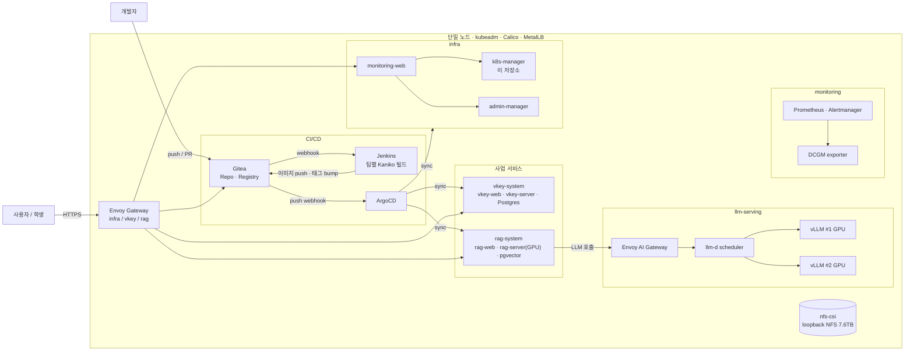

# k8s-manager — GPU 단일 서버 Kubernetes 운영 및 관리서버

대학 AI 사업 2개(가상키 발급 서비스, 문서 기반 RAG 질의 서비스)와 사내 LLM 서빙을 **GPU 서버 1대 위의 Kubernetes**로 구축·운영했다. 이 저장소에는 그 과정에서 만든 다음 세 가지가 들어 있다.

- **관리서버(k8s-manager)**: 클러스터 전체의 Pod/GPU 상태, 빌드·배포 결과를 대시보드로 실시간 전달하는 Node.js 서버
- **인프라 매니페스트**: Gateway, Gitea, Jenkins, ArgoCD, DCGM 등 클러스터 공용 구성
- **설계 기록**: 아키텍처 결정 기록(ADR) 53건

함께 만든 저장소:

| 저장소 | 역할 |
|---|---|
| [admin-manager](https://github.com/milk024/admin-manager) | 고권한 관리 서버. 개발자 K8s 계정(kubeconfig)·Gitea 계정 발급, 네임스페이스 YAML 관리, 감사 로그 |
| [monitoring-web](https://github.com/milk024/monitoring-web) | 운영 대시보드(React). 모니터링·빌드·배포 상태·Pod 상세·YAML 편집·관리자 화면 |
| [deploy-infra](https://github.com/milk024/deploy-infra) · [deploy-rag](https://github.com/milk024/deploy-rag) · [deploy-vkey](https://github.com/milk024/deploy-vkey) | GitOps 배포 저장소(ArgoCD가 읽는 Helm 차트·values) |

> 공개용으로 정리하면서 실제 IP, 도메인, 조직명은 예시값(`10.0.0.x`, `example.ac.kr`, `myorg`)으로, 팀원 실명은 역할로 바꿨고 비밀번호와 토큰은 모두 제거했다. 각 저장소는 운영 이력 대신 정리된 스냅샷 커밋으로 올렸다.

---

## 운영 규모 (2026-11-17 기준)

| 항목 | 수치 |
|---|---|
| 지원 대상 | 개발팀 2개, 개발자 8명 |
| 운영 서비스 | 사업 서비스 2개 + 공용 LLM 서빙 + 인프라(Gitea, Jenkins, ArgoCD, 모니터링, 관리 서버) |
| 클러스터 | namespace 22 · Pod 73 · Deployment 47 · Service 65 · PVC 11 (1.4 TB) |
| 외부 진입점 | Gateway 5개(MetalLB L2), 도메인 3개, HTTPS |
| 하드웨어 | GIGABYTE G493-SB1-AAP1 · 128 thread · 512 GB RAM · NVIDIA L40S × 4 |
| LLM 서빙 | Gemma 4 12B, KServe + llm-d, vLLM Replica 2 |
| 배포 | ArgoCD Application 7개, Jenkins 빌드 대상 저장소 7개 |
| 서비스 사용자 | 가상키 서비스: 학생 100명, 가상키 370개 발급 |

## 아키텍처



## 주요 성과

### CI/CD를 GitOps로 재구성 (2026-11-10 ~ 11-17)

이전 구조는 Gitea Actions Runner(DinD, privileged) 하나가 모든 저장소를 빌드하고, CI가 kubeconfig로 `helm upgrade`를 실행하는 방식이었다. 이를 빌드와 배포로 나눴다.

| 항목 | 이전 | 이후 |
|---|---|---|
| 빌드 | Gitea Actions + DinD Runner 1개 (privileged) | Jenkins + Kaniko, **팀별 빌드 네임스페이스** (privileged 없음) |
| 배포 | CI가 kubeconfig로 `helm upgrade` | CI는 배포 저장소에 이미지 태그만 커밋, **ArgoCD가 동기화** |
| 개발자 클러스터 권한 | 배포 가능 | 조회·디버깅만 (배포는 PR → 승인 → ArgoCD) |
| push → 배포 반영 대기 | ArgoCD 폴링 최대 약 4분 | Gitea push 웹훅으로 **수 초** |
| 빌드 상태 | Runner 로그 확인 | Gitea 커밋 상태(`jenkins/build`)로 대시보드에 실시간 표시 (빌드 중 → 성공/실패) |

- ArgoCD 웹훅이 동작하지 않던 원인은 **저장소 주소 불일치**였다. 웹훅 payload에는 외부 https 주소가, Application에는 클러스터 내부 SSH 주소가 들어 있었다. repoURL을 https로 맞추고 읽기 전용 토큰(제한된 사용자, deploy 저장소 3개만)으로 바꿔 해결했다([ADR-051](docs/adr/0051-argocd-gitops-deployment.md)).
- 저장소 7개를 파일럿 → 순차 방식으로 전환했고, 전환 후 Jenkins 빌드 상태 기록 41건이 모두 성공이다([ADR-052](docs/adr/0052-jenkins-ci.md)).

### 권한 분리와 관리 도구

- Gitea 계정을 개인 계정(dev1~8)·팀·서비스 계정(`ci-*`, `svc-*`)으로 나누고, main 보호 + PR 승인을 적용했다. 공용 관리자 토큰은 폐기했다([ADR-050](docs/adr/0050-gitea-account-permission-split.md)).
- 계정 발급·회수를 **admin-manager**로 모았다. K8s 개발자 계정(ServiceAccount + RBAC 템플릿 + kubeconfig), Gitea 계정(임시 비밀번호, 첫 로그인 변경 강제), 팀 배정, 로그인 시도 제한, 감사 로그.
- 운영 대시보드 전체를 관리자 로그인 뒤에 두고, 관리서버 API·socket.io도 같은 JWT로 검증한다. admin-manager는 모든 네임스페이스를 **조회만**, 수정·삭제는 개발 네임스페이스만 가능하다. 관리 도구 자신이 있는 `infra`는 일부러 쓰기 권한을 주지 않았다([ADR-053](docs/adr/0053-monitoring-web-access-and-ops-screens.md)).

### 운영 화면 (monitoring-web)

| 화면 | 내용 |
|---|---|
| 빌드 | 빌드 대상 앱 전체의 최근 빌드·Jenkins 번호·최근 성공, 실시간 반영 |
| 배포 상태 | ArgoCD Sync·Health·이미지, 관리 리소스별 상태, **빌드 대비**(최신 반영 / 배포 대기 / 빌드 중 / 빌드 실패) |
| Pod 상세 | 소유 체인·Service·HTTPRoute·ConfigMap·Secret(이름만)·PVC, 에러만 보기·직전 크래시 로그, 이벤트 |
| 네임스페이스 YAML | Monaco 편집기, ArgoCD 관리 리소스 읽기 전용, 동시 수정 감지, 변경 이력 |

- "빌드 대비"는 배포된 이미지 태그(커밋 SHA)를 최근 성공 빌드와 비교한다. push 후 어느 단계에서 멈췄는지 한 화면에서 보인다.
- 빌드 요약 API는 처음에 저장소 × 커밋 상태를 동시에 불러 약 55초가 걸렸다. 최신 커밋부터 차례로 보다가 필요한 값을 찾으면 멈추게 바꾸고 캐시를 더해 약 5초(이후 즉시)로 줄였다.

### 장애 대응

| 사례 | 대응 전 | 대응 후 |
|---|---|---|
| OS 자동 업데이트로 인한 NFS 중단 | 전 서비스 26시간 19분 중단 | 원인 제거, 재발 0건 |
| GPU 드라이버 Pod 반복 재시작 | 219회 (부팅 시 커널 헤더 다운로드 실패) | 원인 해소, 0회 |
| GPU 모니터링 누락 | 수집 GPU 0장 (Prometheus 라벨 오류) | 4장 전체 수집 |
| Helm 업그레이드 실패 시 API 토큰 초기화 | 업그레이드 실패 때마다 재발 가능 | Secret 분리, 재발 0건 ([ADR-046](docs/adr/0046-helm-external-secret.md)) |
| 빌드 캐시가 노드 OS 디스크 점유 | DinD 캐시 약 248 GB | Kaniko 전환으로 제거 ([ADR-052](docs/adr/0052-jenkins-ci.md)) |

## 장애 사례: 자동 업데이트 한 번에 전 서비스 26시간 중단

**상황**
- 노드는 `Ready`였지만 가상키 API, RAG DB, Gitea, Prometheus가 동시에 응답하지 않았다.
- load average는 약 9,100이었는데 CPU 사용률은 2%였다.

**원인 추적**
1. load는 높은데 CPU가 놀고 있다 → 프로세스가 I/O 대기(D state)에 묶여 있다고 판단했다.
2. 영향받은 서비스의 공통점은 모두 `nfs-csi` PVC를 쓴다는 것이었다. `node_nfsd_packets_total` 메트릭이 멈춰 있었다.
3. 이 노드는 NFS 서버이자 클라이언트(루프백 NFS)다. `journalctl`을 보니 `nfs-server` 재시작 후 `rpc.nfsd`가 `errno 12 (Cannot allocate memory)`로 실패해 있었다.
4. 재시작한 주체는 사람이 아니었다. apt 기록을 보니 `unattended-upgrades`가 보안 패키지를 설치했고, `needrestart`가 관련 서비스를 자동으로 재시작했다. 58일 무재부팅으로 커널 메모리가 단편화된 상태라 nfsd 기동이 실패했다.
5. 알림이 오지 않은 이유도 찾았다. Prometheus도 같은 NFS 위에 있었고, Alertmanager receiver가 `null`이었다.

**복구**
- `systemctl daemon-reload` → `systemctl start nfs-server` → Error 상태 Pod 재생성
- Postgres는 WAL 재생으로 데이터 손실 없이 기동했다.

**재발 방지** ([ADR-043](docs/adr/0043-os-auto-update-disabled.md), [ADR-044](docs/adr/0044-kernel-pin-highpoint-driver.md))
- `needrestart`를 목록만 보여주는 모드로 바꾸고, unattended-upgrades와 apt 타이머를 비활성화했다. 이제 관리자가 유지보수 창에서 직접 패치한다.
- 자동 설치된 새 커널에는 OS 디스크용 HighPoint RAID 드라이버(`hptnvme.ko`)가 없었다. 그대로 재부팅하면 부팅이 실패하는 상태였다. 그래서 커널을 고정하고(GRUB 기본값 + apt hold) 드라이버 재빌드 절차를 문서화했다.
- 남은 근본 과제(단일 NFS, 알림 부재)는 멀티노드 전환 계획([ADR-045](docs/adr/0045-multinode-transition-rto-rpo.md))에 넣었다.

## 기술 의사결정 (ADR)

전체 목록과 상태는 [`docs/adr/ADR.md`](docs/adr/ADR.md)에 있다. 53건이며, 확정·운영 중 28건, 제안 2건, 대기 15건이다(2026-11-17 기준). 대표 결정은 아래와 같다.

| ADR | 결정 | 핵심 근거 |
|---|---|---|
| [007](docs/adr/0007-ingress-controller-choice.md) | Ingress 대신 Gateway API(Envoy Gateway) | 클러스터에 이미 운영 중, LB IP 절약을 위해 namespace 공용 Gateway 재사용 |
| [014](docs/adr/0014-rbac-networkpolicy-scope.md) | 개발자 namespace 범위 RBAC, 관리 포트 IP 화이트리스트 | 사업 간 권한 격리, 관리 포트 노출 최소화 |
| [043](docs/adr/0043-os-auto-update-disabled.md) | OS 자동 업데이트 비활성화 | 26시간 장애의 직접 원인 |
| [045](docs/adr/0045-multinode-transition-rto-rpo.md) | 멀티노드 전환 크리티컬 패스, Tier별 RTO/RPO | 단일 노드 SPOF가 실제 장애로 확인됨 |
| [046](docs/adr/0046-helm-external-secret.md) | 토큰을 Helm 밖 Secret으로 분리 | 실제 사고: Helm 부분 실패로 토큰이 빈 값으로 덮어써짐 |
| [047](docs/adr/0047-realtime-socket-push.md) | 대시보드 데이터를 socket.io push로 전달 | 브라우저 수와 무관하게 조회는 서버 한 곳, 빌드 결과는 웹훅으로 즉시 |
| [050](docs/adr/0050-gitea-account-permission-split.md) | Gitea 개인·팀·서비스 계정 분리, main 보호 | 공용 관리자 계정·토큰으로 모든 작업을 하던 구조 해소 |
| [051](docs/adr/0051-argocd-gitops-deployment.md) | 배포를 ArgoCD GitOps로, 개발자 kubectl은 조회만 | CI의 kubeconfig `helm upgrade`가 사실상 클러스터 쓰기 권한 |
| [052](docs/adr/0052-jenkins-ci.md) | 빌드를 Jenkins + Kaniko, 팀별 빌드 네임스페이스로 | privileged DinD Runner 하나가 모든 팀 빌드, OS 디스크 캐시 248 GB |
| [053](docs/adr/0053-monitoring-web-access-and-ops-screens.md) | 대시보드 전체 로그인, 관리 도구 권한은 조회 전체·수정 최소 | Pod 로그가 학내망에 열려 있었음, 관리 도구가 자기 자신을 수정할 수 있으면 안 됨 |

## 관리서버 (이 저장소의 코드)

`infra` namespace에서 in-cluster ServiceAccount로 동작하는 Node.js 서버다. 결과는 REST API와 socket.io로 제공한다. 모든 API·소켓은 관리자 JWT가 필요하다(웹훅·헬스체크 제외).

| 기능 | 구현 |
|---|---|
| 클러스터 조회 | 모든 namespace의 Pod, Deployment, Event, NetworkPolicy, Pod 연관 리소스, ArgoCD Application (ClusterRole 조회 전용, Secret 권한 없음) |
| 리소스 모니터링 | Metrics API(Pod CPU/메모리), PromQL(DCGM GPU 사용률, 디스크 I/O) |
| CI/CD 연동 | Gitea REST API, Jenkins 커밋 상태(`jenkins/build`) 기반 빌드 이력·요약, push/status 웹훅 수신 |
| 실시간 전달 | socket.io `monitor:pods`, `monitor:gpu`, `k8s:pods`, `ci:build`, `gitea:push`, `alert:triggered` |
| 인증 | admin-manager JWT(HS256) 검증, 토큰 만료 시 소켓 연결 종료, 비밀값 없으면 전부 거부 |

```
core/        express 앱, 라우터 (k8s · gitea · monitor · mirror · webhook)
services/    K8s · Gitea · Prometheus · socket.io 클라이언트
helpers/     설정, 인증(JWT), 로그, 감사 로그, 메트릭 파서
k8s/         infra Gateway, Gitea·Jenkins·ArgoCD values, DCGM ServiceMonitor
ci/          배포 저장소 이미지 태그 bump 스크립트
docs/adr/    아키텍처 결정 기록 53건
docs/diagrams/  draw.io 아키텍처 다이어그램
```

설치, 환경변수, API 목록은 [`docs/SETUP.md`](docs/SETUP.md)에 정리했다.

## 기술 스택

- **Kubernetes**: kubeadm v1.35, Calico(VXLAN), MetalLB(L2), Gateway API / Envoy Gateway, Envoy AI Gateway, nfs-csi
- **GPU / LLM**: NVIDIA GPU Operator, DCGM exporter, KServe, llm-d, vLLM
- **CI/CD**: Gitea (Repo · Container Registry), Jenkins + Kaniko (Kubernetes plugin, 팀별 cloud), ArgoCD (GitOps, 웹훅)
- **Observability**: kube-prometheus-stack (Prometheus, Alertmanager, node-exporter, kube-state-metrics)
- **App**: Node.js 22, Express 5, socket.io 4, @kubernetes/client-node / React 18, Vite, Tailwind, Monaco Editor
- **OS**: Ubuntu 24.04, HighPoint NVMe RAID

## 남은 과제

- Alertmanager 알림 연결(메일), 알람 그룹핑/침묵
- 관리자 로그인 MFA, pgAdmin 접속 관리, kubeconfig 1년 만료 대응
- 로그 수집(Loki + Fluent Bit)
- [ADR-045](docs/adr/0045-multinode-transition-rto-rpo.md)의 멀티노드 전환: 백업 자동화와 복구 리허설 → VM 멀티노드 리허설 → Control Plane 분리, Worker 추가. 전환 후 목표는 Tier 1 서비스 RTO 30분, DB RPO 15분이다.
